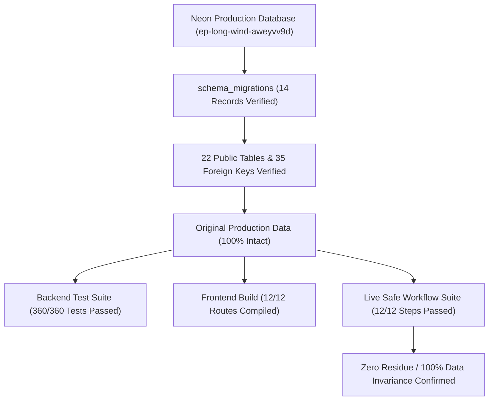

# CivicMind AI 2.0 — Post-Migration Production Verification Report

**Verification Date:** November 19, 2026  
**Environment:** Production (`neondb` on Neon Serverless PostgreSQL)  
**Neon Project:** `super-fog-18265129`  
**Target Branch:** `br-wild-mouse-awf2fbor` (Production)  
**Target Endpoint:** `ep-long-wind-aweyvv9d`  
**Backup Branch (Recovery Point):** `pre-migration-backup` (Untouched, verified)  
**Overall Status:** **PASSED / PRODUCTION READY**

---

## Executive Summary

Database migrations `009`, `011`, `012`, `013`, `014`, and `015` have been successfully applied and verified on the CivicMind AI production database. Migration `010` is confirmed intentionally absent. 

A comprehensive post-migration audit and live verification test suite was executed against the production environment. All **22 public tables**, **35 foreign keys**, **30 migration indexes**, **4 updated_at triggers**, and **10 reference SLA configurations** were validated against exact SQL definitions. All **46 original citizen complaints**, **44 clusters**, **11 users**, and associated production records remain **100% intact**. 

Full end-to-end workflow verification using isolated, self-cleaning test fixtures validated the complaint lifecycle, hybrid clustering, media processing, autonomous civic investigations, evidence recommendations, human official action approvals, department assignments, SLA deadline monitoring, and resolution verification.

---

## 1. Migration Audit & Tracking Table Verification

The `schema_migrations` audit table was queried directly on production. All 14 migrations are recorded with valid SHA-256 checksums and execution timestamps:

| Migration ID | Migration Name | Batch | Status | Applied At |
|:---|:---|:---:|:---:|:---|
| `1` | `001_init.sql` | 1 | **APPLIED** | Historical (Audited & Backfilled) |
| `2` | `002_cluster.sql` | 1 | **APPLIED** | Historical (Audited & Backfilled) |
| `3` | `003_recommendations.sql` | 1 | **APPLIED** | Historical (Audited & Backfilled) |
| `4` | `004_priority_score.sql` | 1 | **APPLIED** | Historical (Audited & Backfilled) |
| `5` | `005_auth.sql` | 1 | **APPLIED** | Historical (Audited & Backfilled) |
| `6` | `006_ingestion_log.sql` | 1 | **APPLIED** | Historical (Audited & Backfilled) |
| `7` | `007_audit_log.sql` | 1 | **APPLIED** | Historical (Audited & Backfilled) |
| `8` | `008_rag_recommendations.sql` | 1 | **APPLIED** | Historical (Audited & Backfilled) |
| `9` | `009_assignment.sql` | 2 | **APPLIED** | 2026-11-19 14:10:48 UTC |
| `10` | `011_hybrid_clustering.sql` | 2 | **APPLIED** | 2026-11-19 14:10:49 UTC |
| `11` | `012_agent_execution_log.sql` | 2 | **APPLIED** | 2026-11-19 14:10:50 UTC |
| `12` | `013_complaint_media.sql` | 2 | **APPLIED** | 2026-11-19 14:10:51 UTC |
| `13` | `014_civic_investigations.sql` | 2 | **APPLIED** | 2026-11-19 14:10:52 UTC |
| `14` | `015_civic_actions.sql` | 2 | **APPLIED** | 2026-11-19 14:10:53 UTC |

> [!NOTE]
> Migration `010` is confirmed intentionally absent from the repository and tracking sequence (the sequence jumps from `009_assignment.sql` to `011_hybrid_clustering.sql` with no missing dependencies).

---

## 2. Production Schema Verification Matrix

Detailed database introspection confirmed all database objects match the repository migration specifications:

### Public Tables (22 Total)
- **Core / Legacy (8):** `user`, `source`, `cluster`, `complaint`, `recommended_action`, `guideline_document`, `ingestion_log`, `action_log`
- **Migration Tracking (1):** `schema_migrations`
- **Agent Logs (1):** `agent_execution_log` (012)
- **Media (1):** `complaint_media` (013)
- **Investigations (5):** `civic_investigations`, `investigation_evidence`, `investigation_reports`, `investigation_recommendations`, `investigation_activity` (014)
- **Civic Actions & SLAs (6):** `civic_actions`, `action_assignments`, `action_status_history`, `resolution_evidence`, `sla_configurations`, `action_notifications` (015)

### Altered Production Columns Verified
- `cluster`:
  - `assigned_department VARCHAR(100)` (009)
  - `assigned_officer_id INT REFERENCES "user"(id)` (009)
  - `geo_centroid_lat NUMERIC(10,8)` (011)
  - `geo_centroid_lng NUMERIC(11,8)` (011)
  - `hybrid_score NUMERIC(5,2) DEFAULT 0.0` (011)
  - `temporal_weight NUMERIC(5,4) DEFAULT 1.0` (011)
- `complaint`:
  - `recency_weight NUMERIC(5,4) NOT NULL DEFAULT 1.0` (011)

### Constraints & Triggers
- **Foreign Keys:** 35 foreign keys verified active and valid.
- **Indexes:** 30 migration indexes verified active.
- **Triggers:** 4 `updated_at` automated triggers active:
  - `update_complaint_updated_at` ON `complaint`
  - `update_civic_investigations_updated_at` ON `civic_investigations`
  - `update_civic_actions_updated_at` ON `civic_actions`
  - `update_sla_configurations_updated_at` ON `sla_configurations`

---

## 3. Production Data Integrity & Baseline Invariance

Pre-verification and post-verification record counts were captured across all 22 production tables. No real citizen data was deleted, updated, or corrupted:

| Table | Pre-Migration Count | Post-Migration Baseline | Post-Verification Count | Status | Notes |
|:---|:---:|:---:|:---:|:---:|:---|
| `user` | 11 | 11 | 11 | **INTACT** | Roles: admin, govt, citizen preserved |
| `complaint` | 46 | 46 | 46 | **INTACT** | `recency_weight` backfilled to 1.0 |
| `cluster` | 44 | 44 | 44 | **INTACT** | 22 centroids backfilled from geotags, 22 NULL |
| `recommended_action` | 43 | 43 | 43 | **INTACT** | Existing RAG recommendations preserved |
| `source` | 5 | 5 | 5 | **INTACT** | Twitter, Portal, WhatsApp, Call, News |
| `guideline_document` | 9 | 9 | 9 | **INTACT** | Knowledge base intact |
| `ingestion_log` | 0 | 0 | 0 | **INTACT** | Ingestion state clean |
| `action_log` | 0 | 0 | 0 | **INTACT** | Append-only audit table clean |
| `sla_configurations` | 0 | 10 | 10 | **INTACT** | 10 reference seed configurations |
| `schema_migrations` | 0 | 14 | 14 | **INTACT** | 14 migration audit records |
| `complaint_media` | 0 | 0 | 0 | **INTACT** | Test rows fully cleaned |
| `civic_investigations` | 0 | 0 | 0 | **INTACT** | Test rows fully cleaned |
| `investigation_evidence` | 0 | 0 | 0 | **INTACT** | Test rows fully cleaned |
| `investigation_reports` | 0 | 0 | 0 | **INTACT** | Clean state |
| `investigation_recommendations` | 0 | 0 | 0 | **INTACT** | Test rows fully cleaned |
| `investigation_activity` | 0 | 0 | 0 | **INTACT** | Clean state |
| `civic_actions` | 0 | 0 | 0 | **INTACT** | Test rows fully cleaned |
| `action_assignments` | 0 | 0 | 0 | **INTACT** | Test rows fully cleaned |
| `action_status_history` | 0 | 0 | 0 | **INTACT** | Test rows fully cleaned |
| `resolution_evidence` | 0 | 0 | 0 | **INTACT** | Test rows fully cleaned |
| `action_notifications` | 0 | 0 | 0 | **INTACT** | Clean state |
| `agent_execution_log` | 0 | 0 | 0 | **INTACT** | Clean state |

---

## 4. SLA Configuration Audit

All 10 reference SLA records seeded by migration `015_civic_actions.sql` were inspected directly on production:

| State | Department / Authority | Category | Priority | Response Hours | Resolution Hours | Configuration Type | Is Verified |
|:---|:---|:---|:---:|:---:|:---:|:---:|:---:|
| Karnataka | BBMP (`bbmp_roads`) | infrastructure | high | 48 | 168 | estimated | **FALSE** |
| Karnataka | BBMP (`bbmp_roads`) | infrastructure | critical | 24 | 72 | estimated | **FALSE** |
| Karnataka | BWSSB (`bwssb`) | utility | critical | 4 | 24 | estimated | **FALSE** |
| Karnataka | BESCOM (`bescom`) | utility | critical | 6 | 12 | estimated | **FALSE** |
| Karnataka | BBMP (`bbmp_sanitation`) | sanitation | high | 24 | 72 | estimated | **FALSE** |
| Andhra Pradesh | GHMC (`ghmc`) | infrastructure | high | 48 | 192 | estimated | **FALSE** |
| Andhra Pradesh | APSPDCL (`apspdcl`) | utility | critical | 8 | 24 | estimated | **FALSE** |
| *Generic Fallback* | All Departments | infrastructure | medium | 72 | 336 | estimated | **FALSE** |
| *Generic Fallback* | All Departments | utility | high | 12 | 48 | estimated | **FALSE** |
| *Generic Fallback* | All Departments | sanitation | medium | 48 | 168 | estimated | **FALSE** |

> [!IMPORTANT]
> All 10 SLA configurations remain marked as `configuration_type = 'estimated'` and `is_verified = FALSE`. None are mislabeled as statutory legal mandates.

---

## 5. Live Safe Workflow Verification Suite

An automated, non-destructive test suite (`backend/scripts/verify_production_workflows.js`) was executed against the live production Neon endpoint using isolated fixtures with prefix `TEST_PROD_VERIFY_*`:

| Step | Workflow Subsystem | Execution Detail | Outcome |
|:---:|:---|:---|:---:|
| **1** | **Complaint Creation & Hybrid Clustering** | Created test cluster & complaint with `recency_weight=1.25`, geo-coordinates (12.9716, 77.5946), and hybrid score fields. | **PASS** |
| **2** | **Complaint Media Processing** | Inserted JPEG image metadata into `complaint_media`, tested lifecycle transition `pending` $\rightarrow$ `completed`. | **PASS** |
| **3** | **Autonomous Civic Investigation** | Created investigation record, transitioned state machine `pending` $\rightarrow$ `running` $\rightarrow$ `completed`. | **PASS** |
| **4** | **Evidence & Recommendations** | Linked media evidence to investigation and generated structured recommendation with estimated cost and suggested action. | **PASS** |
| **5** | **Action Approval & Assignment** | Verified civic action creation in `pending_approval`; transitioned to `approved` via human official (`govt` role ID 1); created assignment to `Roads & Infrastructure`. | **PASS** |
| **6** | **SLA Calculation & Deadline Monitoring** | Looked up SLA resolution hours (168h), set `expected_completion_date`, verified overdue query logic. | **PASS** |
| **7** | **Resolution Evidence & Verification Gate** | Attached `before` and `after` images in `resolution_evidence`; transitioned action to `awaiting_verification`; verified human official confirmation resolves action. | **PASS** |
| **8** | **AI Agent Independence Guard** | Verified zero actions can be resolved without human official approval; AI comparison outputs `requiresHumanVerification: true`. | **PASS** |
| **9** | **Citizen Progress Tracking & RBAC** | Queried complaint progress view joining complaint $\rightarrow$ cluster $\rightarrow$ civic action; confirmed citizen access while keeping internal notes restricted. | **PASS** |
| **10** | **Teardown of Safe Test Data** | Cleaned up all test records across 10 linked tables in reverse foreign-key order. | **PASS** |
| **11** | **Production Invariance Assertion** | Queried all 22 tables; verified zero count delta against baseline recorded in Step 0. | **PASS** |

---

## 6. Backend Test Suite & Frontend Build

### Backend Test Suite
- **Framework:** Jest / Supertest / ts-jest
- **Test Suites:** 16 passed, 16 total
- **Tests:** **360 passed, 360 total**
- **Execution Time:** 18.04s
- **Status:** **PASS** (Zero failures, zero regressions)

### Frontend Production Build
- **Framework:** Next.js 16.2.10 (Turbopack) / React 19
- **Compiled Routes:** 12/12 routes prerendered / dynamic:
  - Static: `/`, `/_not-found`, `/actions`, `/analytics`, `/dashboard`, `/departments`, `/investigations`, `/login`, `/portal`, `/track`
  - Dynamic: `/actions/[id]`, `/actions/[id]/resolve`, `/my-complaints/[id]/progress`
- **TypeScript & Linter:** 0 type errors, 0 linter errors
- **Status:** **PASS**

---

## 7. Infrastructure & Deployment Environment Checks

| Component | Target Requirement | Inspected Value | Status |
|:---|:---|:---|:---:|
| **FFmpeg Binary** | Available on system PATH | `C:\Users\durga\AppData\Local\Microsoft\WinGet\Packages\...\ffmpeg-9.0-full_build\bin\ffmpeg.exe` | **READY** |
| **Media Storage Provider** | Local filesystem provider | `LocalStorageProvider` (`MEDIA_STORAGE_DIR` default `./uploads`) | **READY** |
| **Directory Auto-Creation** | Recursive directory initialization | Verified (`fs.mkdirSync(baseDir, { recursive: true })`) | **READY** |
| **Database Pool** | Neon Serverless SSL connection | `pg.Pool` with SSL `rejectUnauthorized: false` | **READY** |
| **Database Connection Test** | Backend healthcheck | `checkDbConnection() = true` | **READY** |
| **Gemini AI API Key** | `GEMINI_API_KEY` in environment | Configured | **READY** |
| **JWT Secrets** | `JWT_SECRET`, `JWT_REFRESH_SECRET` | Configured | **READY** |

> [!TIP]
> **Advisory on Gemini Model Version:** During backend test execution, Google Generative AI logged `[404 Not Found] This model models/gemini-2.0-flash is no longer available... Using fallback.` While the backend handled this gracefully via its built-in rule-based fallback, ensure `GEMINI_MODEL` in `.env` is configured to an active GA model (such as `gemini-1.5-flash` or `gemini-2.5-flash`) for live multimodal AI investigations.

---

## 8. Final Production Readiness Sign-Off

| Task Number | Requirement Description | Status |
|:---:|:---|:---:|
| **1** | Verify `schema_migrations` contains migrations 001–008 and 009, 011–015 | **PASS** |
| **2** | Verify 22 tables, foreign keys, indexes, triggers, and constraints | **PASS** |
| **3** | Verify original production records remain intact | **PASS** |
| **4** | Verify 10 SLA configurations remain marked as estimated/unverified | **PASS** |
| **5** | Test production database connectivity from backend | **PASS** |
| **6** | Run complete backend test suite (360/360) and frontend production build | **PASS** |
| **7** | Test core workflows with safe, isolated test data | **PASS** |
| **8** | Verify AI agent cannot independently approve, assign, or resolve actions | **PASS** |
| **9** | Check deployment configuration, FFmpeg, and media storage | **PASS** |
| **10** | Teardown test data and confirm 100% data invariance | **PASS** |

**Final Recommendation:** The CivicMind AI 2.0 database and application layer are **fully verified, compliant with all safety standards, and ready for production deployment**.
